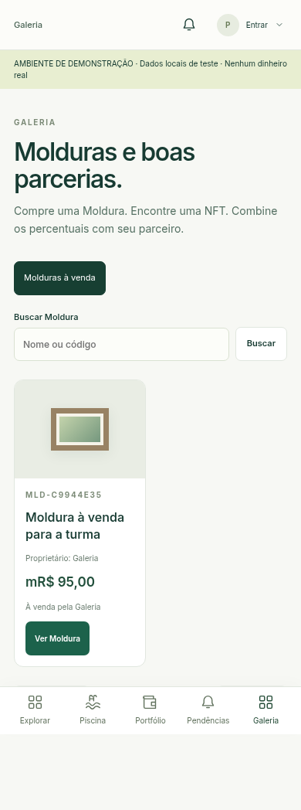
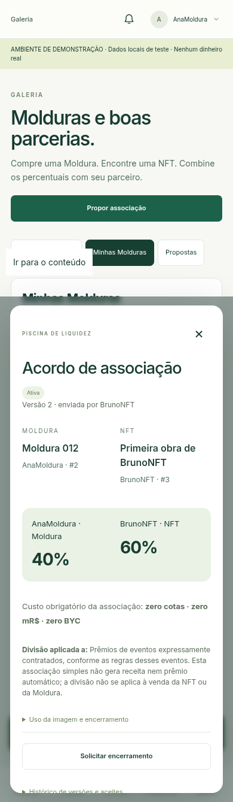
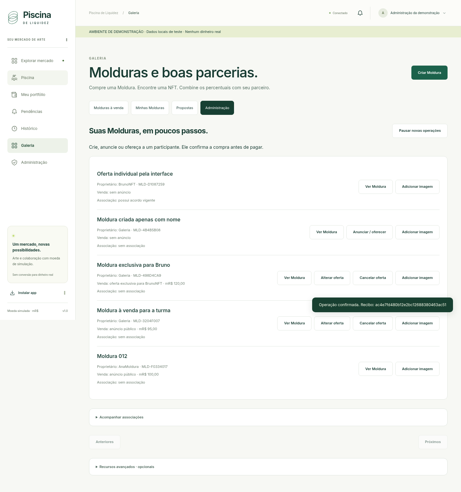

# Galeria — testes da simplificação de 06/11/2026

Verificação local com dados sintéticos isolados: PHP **8.3.36**, MySQL/InnoDB
**8.0.46**, GD/BCMath/PDO MySQL e Chromium **151**, por Playwright. Não houve
implantação, SQL, SMTP externo ou teste de carga na hospedagem de produção.
MariaDB e outros navegadores móveis não foram verificados nesta entrega.

## Resultado executado

| Verificação | Resultado |
|---|---|
| Suíte integrada de domínio | **113 cenários, zero falhas**: 63 anteriores + 30 da Galeria avançada + 20 simples |
| UX simples / API real | **11 grupos na raiz e 11 em `/piscina`**, aprovados |
| Fluxo avançado original / API real | 12 grupos de catálogo/Admin/negociação, aprovados |
| Evento/votação original | 5 grupos na raiz e 5 em subpasta, aprovados |
| Jornadas anteriores do app | 17 grupos, aprovados |
| Troca de imagem Admin | 7 grupos, aprovados |
| Danger Zone | 8 grupos, aprovados |
| Menu de instalação/atualização do PWA | 6 grupos, raiz/subpasta, aprovados |
| Upgrade 004 → 005 reaplicado duas vezes | **59 tabelas anteriores preservadas**, recursos em stand-by e conciliação vazia |
| Sintaxe / distribuição | PHP/JS, `git diff --check`, CRC/conteúdo e hashes dos ZIPs conferidos |

Logs resumidos: [RESULTADOS_GALERIA.txt](RESULTADOS_GALERIA.txt).

A regressão detectou uma venda por valor zero usada legitimamente no fluxo
avançado original. Esse comportamento foi preservado para os ativos anteriores;
a compra de uma nova Moldura simples continua exigindo preço positivo. O fluxo
Admin também foi conferido pela entrada real **Gerenciar Galeria**, que agora
abre a administração simples, com o painel original na área opcional.

## O que os 20 casos novos cobrem

- Criação pelo Admin só com nome, sem fotografia, ponto, local, agenda ou cotas.
- Preço positivo para novas Molduras simples; saldo insuficiente não transfere
  nem cobra parcialmente. Uma oferta não debita o destinatário.
- Oferta exclusiva sem preço exposto a terceiro; somente o destinatário compra.
- Compra concorrente com processos/conexões independentes; uma entrega e um
  pagamento. Recibos/cliques repetidos não duplicam operação.
- Dono da Moldura escolhendo NFT de outra pessoa e dono da NFT iniciando proposta.
- Contraproposta com percentuais livres, nova versão e dois aceites exatos.
  Proponente pode cancelar; terceiro não negocia em nome das partes.
- Mesmo dono confirmando a vinculação diretamente, sem duas pessoas fictícias.
- 0%/100% permitidos; negativos, mais de duas casas e soma diferente de 100%
  recusados. Não há porcentagem mínima imposta.
- Conclusão com **zero cotas disponíveis**, sem reserva ou lançamento de cobrança.
- Corridas reais: a mesma Moldura ou a mesma NFT só entra em uma associação
  vigente; propriedade é revalidada na conclusão de propostas.
- Revenda pode ser anunciada durante associação, mas sua conclusão aguarda o
  encerramento consensual. Termos e beneficiários antigos não são substituídos.
- Depósito nativo continua funcionando e suspende o vínculo incompatível;
  termos, mídia referenciada e histórico são preservados.
- Consulta/resolução com novas contratações pausadas. Ativar recursos futuros
  não modifica acordos simples nem cria débito.
- Proposta física anterior continua operável sob sua regra de X cotas, mesmo
  com os novos recursos em stand-by, sem conversão ou recobrança.

## Interface e regressões

A interface real foi exercitada em **320, 360, 390, 412, 700, 701, 768, 1024 e
1440 px**, sem rolagem horizontal no catálogo. Admin/acordos também foram
verificados em celular. Criação mínima, busca de participantes/NFTs, oferta
exclusiva, revisão de compra, contraproposta 30/70 → 40/60, aceite, encerramento
e vinculação direta foram executados pela interface.

A compra simula perda da resposta **após o commit** e recupera o recibo sem
novo débito. A área avançada continua funcionando, inclusive QR/votação,
revisão/premiação, troca de imagem, Danger Zone, recuperação de senha, calendário,
carteiras e negociação nativa. O painel avançado também recebe Molduras simples
sem mostrar dimensões/local fictícios ou valores `undefined`.

As jornadas da Galeria usam API/PHP/MySQL reais. Somente o teste específico do
menu PWA usa API simulada, com service workers reais. O cache contém estáticos,
sem carteiras, API, votos ou mídia dinâmica. Instalação/atualização permanecem
explícitas, com operações pendentes protegidas.

## Prova de atualização do banco

`tests/molduras-simples-upgrade.php` cria um banco local separado vazio,
`piscina_molduras_upgrade`, com 001–004. Semeia usuários/NFT reais de teste,
carteiras, Moldura física vendida, oferta com prazo, política X = 2 e proposta
pendente. Calcula hashes de todas as linhas das 59 tabelas anteriores (exceto o
registro de migrações), aplica a 005 **duas vezes** e compara os hashes.

Resultado: linhas anteriores intactas, recursos novos em stand-by e listas de
conciliação vazias. A alteração de nulabilidade de `galeria_offers.expires_at`
não modifica valores existentes. Não há datas, pontos ou espaços artificiais
para viabilizar contratos novos.

## Reproduzir em desenvolvimento

Use **exclusivamente** `environment=demo` e `dbname=piscina_test`, num MySQL
isolado. A suíte de domínio apaga e recria todas as tabelas desse banco. Defina
`PISCINA_CONFIG` para configuração/armazenamento/sessões privados de teste,
`galeria.enabled=true`, `mail_transport=file`. Não use a configuração da conta
operacional da Superdomínios.

```sh
php tests/run.php
# Subconjunto focado, também destrutivo no banco descartável:
PISCINA_TEST_FILTER='Molduras simples:' php tests/run.php
```

Para o navegador, prepare novamente um `piscina_test` vazio e defina privadamente
`PISCINA_DEMO_ADMIN_PASSWORD` e `PISCINA_DEMO_PASSWORD`, com ao menos 12 caracteres.
O gerador abaixo recusa banco preenchido e não apaga registros:

```sh
php tests/molduras-simples-demo.php > fixture-simples.json
# Em outro terminal, com a mesma configuração privada:
php -S localhost:8146 -t public
# Com TEST_URL e GALERIA_FIXTURE apontando para servidor/JSON locais:
node tests/molduras-simples-browser.cjs
```

`TEST_URL` é a origem e `TEST_BASE_PATH` é vazio ou `/piscina`. Na subpasta,
configure os mesmos valores no PHP e sirva `public/` nesse caminho. Configure
`TEST_ARTIFACTS` e `CHROMIUM_PATH` se necessário. O teste exige as duas senhas da
fixture no ambiente e usa somente os participantes sintéticos aprovados.

Para o upgrade, o usuário MySQL local precisa poder criar o banco separado
**vazio** `piscina_molduras_upgrade`:

```sh
php tests/molduras-simples-upgrade.php
```

A demonstração avançada anterior permanece em `tests/galeria-demo.php`, com os
casos `--win` e `--tie` de quatro coalizões, 16 cotas e prêmio de mR$ 1.000.
A cobrança e as funções originais continuam cobertas pelos 30 testes avançados.
O novo gerador simples usa a concessão nativa de mR$ 1.600 e não emite cotas.

## Prévias reais da demonstração







## Limites

Não foi medido throughput do plano de hospedagem ou feito teste remoto com a
turma. Associação simples registra a parceria e os percentuais, sem prêmio
ou receita automática; participar de um evento avançado requer termos próprios,
consentimento e financiamento. Verificações físicas continuam humanas quando
esse recurso for utilizado. A produção depende da instalação da 005 e dos
arquivos compatíveis; não foi alterada por estes testes.
