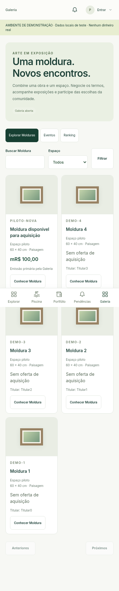
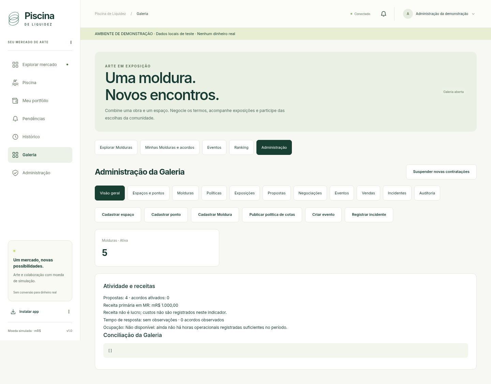
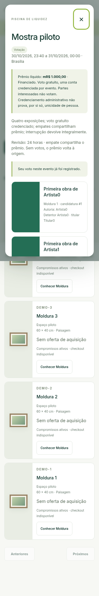

# Galeria — verificação executada e demonstração

Verificação local em 31/10/2026, com dados sintéticos isolados. PHP **8.3.36**,
MySQL/InnoDB **8.0.46**, BCMath/GD/PDO MySQL e Chromium **151** por Playwright.
Não houve teste de carga, implantação ou execução de SQL na produção da
Superdomínios. MariaDB e a configuração da hospedagem não foram verificados.

## Resultados

| Execução | Resultado |
|---|---|
| Linha de base, antes da integração | 63 cenários de domínio e 19 de autenticação, zero falhas |
| Regressão integrada com Galeria ligada | 90 cenários: 63 antigos + 27 da Galeria, zero falhas |
| Galeria, após os três últimos casos adicionados | 30 cenários, zero falhas |
| Jogo anterior com flag privada da Galeria falsa | 63 cenários, zero falhas |
| Interface/API reais, catálogo/Admin/negociação | 12 grupos na raiz + 12 em `/piscina`, aprovados |
| Interface/API reais, evento/votação | 5 grupos na raiz + 5 em `/piscina`, aprovados |
| Jornadas anteriores no navegador | 17 grupos do app, 7 da troca de imagem, 8 da Danger Zone, aprovados |
| PWA: instalação/atualização explícita | 6 grupos, raiz e subpasta, aprovados também após os últimos ajustes |
| Upgrade 003 → 004, reaplicada duas vezes | 31 tabelas antigas preservadas integralmente; carteira/NFT de teste intactas |
| Demonstrações CLI: vencedor e empate | Prêmio exato de mR$ 1.000,00 em cada execução; sem duplicação |
| Conciliação após demonstração | Todas as seções canônicas e da Galeria vazias |
| Sintaxe e integridade | PHP, JS, CRC/conteúdo dos ZIPs e `git diff --check` conferidos |

A execução completa de 90 precedeu três casos adicionais de confirmação
administrativa e alteração de condições físicas. A suíte focada final contém
os 30 casos e passou, assim como a interface real de negociação na raiz e em
subpasta. Não se apresenta essa sequência como uma execução completa de 93.

O resumo textual dos resultados está em
[RESULTADOS_GALERIA.txt](RESULTADOS_GALERIA.txt). Os testes executáveis e o
gerador de demonstração estão em `tests/galeria-*`, no pacote completo.

## Riscos cobertos

- Flag desligada/suspensão, permissões por objeto, CSRF, senha Admin, versões,
  valores manipulados, saldo insuficiente e autorizações expiradas.
- Corridas reais com processos e conexões independentes: compra da mesma
  Moldura, agenda, uso concorrente das mesmas cotas, duplicação de voto e
  encerramento simultâneo com votação. O gate e as transações são os existentes.
- X = 2 por parte, 16 cotas totais para quatro coalizões. Reserva canônica
  vinculada ao usuário, Q/direitos originais preservados, captura/devolução sem
  emissão, destruição, saldo negativo ou cobrança parcial.
- Proposta, contraproposta e dois aceites da mesma versão. Revenda bilateral
  pela interface, preço exato, propriedade e pagamento atômicos; mudanças de
  local/condições cancelam ofertas antigas e exigem novo consentimento.
- NFT pública inelegível e normalmente retirável; venda, depósito ou mudança
  de mídia suspendem a exposição afetada. A imagem votada não é remapeada nem
  apagada pela limpeza de uploads. Exclusão do usuário encaminha à custódia.
- Mínimo, infraestrutura e prêmio integralmente financiados antes de votar;
  credenciamento único, partes interessadas recusadas e ausência de parciais
  públicas ou dados pessoais do eleitor no catálogo.
- Revisão versionada, invalidar voto com motivo, empate, zero votos, resíduos,
  prazo de revisão, repetição de liquidação e incidente depois do pagamento.
- Ranking definitivo, empate denso, filtro de espaço histórico e conservação
  dos beneficiários após revenda/arquivamento. Ocupação com horas prospectivas
  efetivamente registradas e manutenção descontada.
- Resposta perdida **depois do commit**, recuperação de recibo sem reenviar
  compra; compatibilidade da consulta com o PWA anterior. Atualização bloqueada
  durante operação pendente. Cache contém somente estáticos autorizados.

Catálogo/Admin: larguras 320, 360, 390, 412, 700, 701, 768, 1024 e 1440 px,
sem rolagem horizontal. A votação também foi exercitada em 320 px. As duas
instalações usaram o PHP/API reais, com bancos de demonstração recriados entre
jornadas; apenas o teste específico do menu PWA usa API simulada.

## Reproduzir com segurança

Use um ambiente local e **exclusivamente** `environment=demo` e
`dbname=piscina_test`, em um MySQL isolado. A suíte `tests/run.php` apaga e
recria as tabelas desse banco. Não use credenciais nem cópia operacional da
hospedagem. Configure `PISCINA_CONFIG` para um arquivo privado, armazenamento
e sessões de teste, `galeria.enabled=true` e `mail_transport=file`.

```sh
php tests/run.php
# Subconjunto focado, também destrutivo no banco descartável:
PISCINA_TEST_FILTER=Galeria php tests/run.php
php tests/auth-limits.php
```

Para demonstrar um evento completo, prepare outra vez um `piscina_test`
**vazio**. O gerador exige `PISCINA_DEMO_ADMIN_PASSWORD` e
`PISCINA_DEMO_PASSWORD` definidos privadamente, com pelo menos 12 caracteres.
Não tem senha de fábrica e se recusa a apagar registros existentes.

```sh
php tests/galeria-demo.php --win > demonstracao-vencedor.json
# Em outro banco vazio, com a mesma configuração isolada:
php tests/galeria-demo.php --tie > demonstracao-empate.json
php bin/reconcile.php
```

Cada caso cria quatro Molduras, quatro coalizões e X = 2 por parte. Somente a
fixture aumenta o crédito inicial para viabilizar as jornadas, gera imagens
sintéticas e avança o relógio da sessão MySQL. O Admin de produção não ganha
esses recursos. A soma de 16 cotas é separada do prêmio MR financiado com
receita primária existente.

No caso vencedor, a primeira candidatura recebe os 1.000: NFT 600 e Moldura
400, conforme 60%/40%. No empate, cada uma das duas candidaturas recebe 500:
a primeira divide 300/200 e a segunda, com 45%/55%, divide 225/275. As quatro
participações cumpridas são capturadas independentemente de vitória.

Para navegador, `--ui` gera catálogo/propostas para negociar e `--live` prepara
votação aberta com eleitor de demonstração. Use banco vazio em cada modo.
Execute o PHP local servindo `public/`; para subpasta, sirva-o em `/piscina`
e configure `url`/`base_path` correspondentes. Exporte `TEST_URL` com a origem
e `TEST_BASE_PATH` com `''` ou `/piscina`, as duas senhas e
`CHROMIUM_PATH` quando necessário. Grave a saída do gerador no caminho de
`GALERIA_FIXTURE` e execute:

```sh
GALERIA_BROWSER_MODE=ui node tests/galeria-browser.cjs
# Repita com fixture --live e GALERIA_BROWSER_MODE=live.
npm run test:pwa
```

`tests/galeria-upgrade.php` exige a mesma configuração local e permissão de
criar um banco **vazio** `piscina_galeria_upgrade_test`. Semeia 001–003 com um
usuário/NFT sintéticos, calcula hashes de todas as linhas antigas, aplica a
004 duas vezes e compara o resultado. Não apaga esse banco para reutilizá-lo.

## Prévias reais da demonstração







## Limites da validação

Não foi medido throughput da hospedagem compartilhada. A consistência foi
testada sob corridas independentes, mas a capacidade de uma turma depende do
plano/cron/PHP/MySQL do servidor final. Credenciamento e confirmação física
continuam sendo verificações humanas. Não foi testado SMTP externo nem
comportamento de instalação em todos os navegadores móveis nesta entrega.
